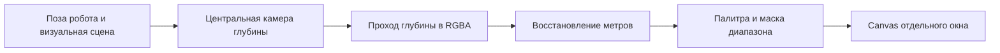

# Дизайн: цветная карта глубины

## Информация о документе
- Дата: 2026-11-18. Версия: 1.0.
- Статус: утверждён пользователем и реализован 2026-11-18; приёмка PASS, см. evidence.md.
- Требования: [requirements.md](requirements.md), утверждены 2026-11-18.
- ADR: [.kiro/decisions/0001-depth-map-render-pass.md](../../decisions/0001-depth-map-render-pass.md).
- Основание проверки: исходники Three.js 0.181.2, независимое ревью, unit/GPU/browser проверки и четыре 30-секундных замера (evidence.md).

## Обзор
Отдельное немодальное окно внутри страницы показывает фронтальную цветную карту глубины 0–2 м. Центральный ракурс совпадает с ракурсом RGB. Карта работает с визуальной сценой Three.js и не зависит от YOLO, ROS или подключения физической камеры.

### Цели
- Учитывать ближайшие поверхности, включая декоративные деревья, кусты и пол.
- Сохранять центральный ракурс при движении и наклоне робота.
- Не изменять состояние основного рендера и жизненный цикл распознавания.

### Технический выбор
Основной путь — MeshDepthMaterial с RGBADepthPacking, отдельная RGBA8-цель 320×240, чтение пикселей, перевод в метры и раскраска на CPU. Это использует существующий WebGLRenderer и не требует зависимостей.

Альтернативы: попиксельные лучи по Three.js-сцене потребуют множества пересечений; DepthTexture с GPU-раскраской потребует дополнительного прохода и организации вывода; стереосопоставление потребует калибровки и решает другую задачу. Основной риск выбранного варианта — задержка синхронного чтения GPU. При неприемлемом замере вернуться к дизайну GPU-вывода, а не скрывать деградацию.

## Архитектура

### Встраивание
- В `src/main.js`, после успешного `await app.sim.init(...)`, создать контроллер окна и связать кнопку открытия. При неготовом симуляторе кнопка недоступна с пояснением.
- В `src/sim/sim.js` добавить узкий необязательный callback `onDepthFrame(timeMS)`. Вызывать после синхронизации поз и `drawTendonsAndFlex`, до основного render. Не использовать существующий `onStep`: он относится к проигрыванию движений.
- Глубина использует тот же кадр сцены. Перед проходом обновить world matrices сцены и камеры, включая дочерние меши. Свой animation loop или параллельный async render не добавлять.
- Обработчик глубины перехватывает ошибки, чтобы основной render продолжался.

## Компоненты и интерфейсы

| Файл | Назначение и контракт |
|---|---|
| `src/vision/depth-map.js` (новый) | `DepthMap(sim, canvas)`: `open()`, `close()`, `update(timeMS)`, `invalidate()`, `dispose()`. Владеет камерой, target, материалом, массивами, метриками и DOM-обработчиками окна. |
| `src/vision/depth-math.js` (новый) | Чистые функции распаковки, перевода в метры, классификации диапазона и палитры; доступны проверкам без WebGL. |
| `src/vision/depth-map.css` (новый) | Размеры окна, canvas 4:3, шкала, состояния и адаптация к экрану. |
| `src/vision/robot-camera.js` (существующий) | Переиспользовать `createRobotVisionCamera(sim)` для отдельного экземпляра. Общий CAMERA_CONFIG и RGB-камеру не менять. |
| `index.html` | Кнопка «Карта глубины» в управлении симулятором и отдельное окно вне скрываемого `#tab-cv`. |
| `src/main.js`, `src/sim/sim.js` | Создание, привязка callback, сброс устаревшего кадра, очистка при уходе со страницы. |

Весь код — текущий JavaScript ESM. HTTP API, хранилище, установка новых библиотек и миграции не нужны.

## Данные и параметры

| Параметр | Значение / назначение |
|---|---|
| width × height | 320×240, независимо от CSS-размера окна |
| near / far | 0.001 / 3.0 м для камеры глубины; far больше отображаемого диапазона |
| maxDepth | 2.0 м вдоль оптической оси |
| boundaryEpsilon | 0.001 м, только для численной погрешности границы 2 м |
| updateHz | Старт 10 Гц, максимум 15 после замера; выбранные 12 Гц после пограничного результата 9.99957 Гц при настройке 10 |
| rawPixels | Один повторно используемый Uint8Array RGBA |
| depthMeters | Float32Array; NaN для отсутствующих/невалидных измерений |
| image | Повторно используемый ImageData с непрозрачной палитрой |
| state | closed / open / error / disposed |
| metrics | captureMs, colorizeMs, frameCount, actualHz; для проверки производительности |

Ближняя плоскость — технический предел виртуальной камеры, не характеристика настоящего сенсора. Сохранить FOV 90°, aspect 4:3 и transform из CAMERA_CONFIG. Имя нового экземпляра — `robot-depth-camera`.

## Проход глубины и преобразование
1. Пропустить update, если окно закрыто, документ скрыт, компонент disposed или ещё не наступил интервал. Не догонять пропущенные измерения пачкой.
2. Сохранить изменяемое состояние renderer/scene. Установить `scene.background=null`, `scene.overrideMaterial` в MeshDepthMaterial с RGBADepthPacking, NoBlending и отключённым tone mapping. На время измерения установить `shadowMap.autoUpdate=false`, чтобы не обновлять тени с материалом глубины.
3. Использовать target RGBA/UnsignedByte, NoColorSpace, без mipmaps и MSAA, с depthBuffer. Target задаёт собственный viewport 320×240 и выключенный scissor; глобальные определения renderer не менять. Очистить цвет в белый RGBA=(255,255,255,255), глубину — в дальнюю плоскость. Белый sentinel означает «нет поверхности».
4. Отрисовать визуальную сцену и прочитать RGBA. Цветовые эффекты, туман и фон не участвуют в измерении. Учитывать фронтальные стороны непрозрачных поверхностей; служебные helpers исключить на время прохода с восстановлением видимости.
5. В `finally` восстановить target (включая cube face/mipmap при наличии), тем самым возвращая его viewport/scissor/scissorTest; глобальные определения не изменялись. Восстановить autoClear, clearColor/alpha, outputColorSpace, toneMapping, shadowMap.autoUpdate, background, fog, overrideMaterial и все временно изменённые visible-флаги. Глобальный ColorManagement не менять.
6. Перевести байты в перспективную глубину по упаковке именно Three.js 0.181.2. Для нормированных каналов r,g,b,a коэффициенты: `(255/256, 255/65536, 255/16777216, 1/16777216)`. Их скалярное произведение даёт d.
7. Осевое расстояние: `z = near * far / (far - d * (far - near))`. Не использовать простое умножение d на 2. Sentinel, нечисловые результаты и значения вне рабочего диапазона — нейтральный цвет. Значения до 2.001 м считать границей 2 м и ограничивать палитру её концом.
8. Перевернуть строки readback по вертикали один раз при записи ImageData. Горизонтальное отражение не выполнять.

Формулы сверены с исходниками версии 0.181.2; их правильность на GPU дополнительно проверяется контрольной сценой. Рендерер проекта не использует logarithmic/reversed depth; при включении таких режимов нужен пересмотр преобразования.

### Геометрия и материалы
Пол остаётся видимой поверхностью. Внешние части робота, реально попадающие в обзор, также дают глубину. Не скрывать всего робота ради красивой картинки: это скроет лапы и нарушит перекрытия. Если камера окажется внутри меша корпуса, отдельно проверить положение оптической точки; не сдвигать её молча относительно RGB.

Глобальный depth material рассчитан на геометрию текущей непрозрачной сцены. Прозрачность и alpha-test будущих текстур не становятся автоматически моделью измерения; для таких объектов понадобится отдельное правило. Пруд текущей сцены трактуется как геометрическая поверхность.

## Окно и взаимодействие
- Заголовок «Карта глубины · до 2 м», canvas 4:3, фиксированная шкала, подпись «Глубина вдоль взгляда камеры» и нейтральный образец «Вне диапазона / нет данных».
- Цветовые опоры по глубине: 0 м — красный, 0.5 — жёлтый, 1 — зелёный, 1.5 — голубой, 2 — синий. Между опорами линейная интерполяция цветов; шкала не зависит от кадра.
- Немодальное окно поверх страницы, размер ограничен viewport; управление симулятором остаётся доступно. По уточнению 2026-11-18 заголовок служит областью drag для мыши/касания: pointer capture, clamp с отступом 12 px, повторный clamp после resize/open. Close/dispose/pointercancel/lostcapture завершают drag. Положение хранится в inline left/top до пересоздания контроллера; ракурс камеры не меняется. Контракт: `.kiro/specs/depth-window-drag/requirements.md`.
- Кнопка открытия доступна независимо от вкладки CV и готовности YOLO. Окно всегда обозначает данные симулятора, даже при включённом ROS-подключении.
- Закрытие кнопкой и Escape при фокусе внутри окна. Не перехватывать существующую обработку Escape для остановки движения. Вернуть фокус кнопке открытия, использовать aria-label и aria-expanded.
- Визуальный размер задаёт нижняя правая pointer-ручка: ширина 260–640 px с ограничением viewport−24 px, автоматическая высота и canvas 4:3. Стрелки на ручке меняют ширину шагом 20 px и не доходят до управления роботом. Размер хранится в inline width между открытиями; GPU-кадр остаётся 320×240. Sticky-ручка доступна при прокрутке содержимого. Resize и drag взаимоисключены; up/cancel/lostcapture/close/dispose завершают захват. Контракт: `.kiro/specs/depth-window-resize/requirements.md`.

## Жизненный цикл и ошибки
- Ресурсы создать при первом открытии; close останавливает вычисления и сохраняет один комплект для повторного открытия.
- При переключении CV/конструктора открытое окно продолжает работать; управление зрением `window.__vision` не трогать.
- Пауза физики не останавливает карту: в проекте объекты можно двигать мышью на паузе.
- После reset вызвать invalidate: скрыть старый кадр и захватить новый после синхронизации поз в ближайшем render.
- При скрытии документа измерения прекратить; при возврате запросить свежий кадр без догоняющего цикла.
- При ошибке target/readback прекратить измерения, показать «Карта глубины недоступна», записать одну диагностическую ошибку. Закрытие и повторное открытие повторяет инициализацию; бесконечных автоматических повторов нет.
- При потере WebGL-контекста пометить кадр недействительным; после восстановления повторное открытие создаёт ресурсы заново. Сам основной renderer компонент не пересоздаёт.
- dispose идемпотентно освобождает target/material, удаляет свою камеру из base_link, callback и слушатели. pagehide освобождает компонент; при восстановлении страницы из bfcache на pageshow создать новый закрытый контроллер.

## Производительность
На текущем компьютере в Chrome/Edge зафиксировать версии браузера, GPU и размер viewport. Сравнить одинаковые 30-секундные прогоны после прогрева: карта закрыта; карта открыта; карта плюс YOLO. Записать медиану FPS, p95 длительности основного кадра, длительность depth-pass/readback и частоту карты.

Цель: не менее 10 обновлений/с и снижение медианного FPS не более 20% относительно того же режима с закрытой картой. Это критерий будущей проверки, не результат замера. Если цель не достигнута, сначала проверить 160×120 при 10 Гц; изменение качества явно отразить в UI/документации. Если и это не помогает — пересмотр реализации до закрытия задачи. После закрытия окна число измерений не увеличивается.

## Стратегия проверки
| Проверка | Критерий | Требования |
|---|---|---|
| Чистая математика | Опорные значения near/far, байты sentinel, палитра, границы, NaN и переворот строк | FR-3, FR-4 |
| GPU-контроль | Независимо заданные плоскости на 0.5/1/1.5/2 м, ошибка не более 2 см вдали от краёв; 2.01 м нейтрально | FR-3 |
| Плоскость поперёк взгляда | Одинаковая осевая глубина в центре и по краям | FR-2, FR-3 |
| Пустой кадр | Небо нейтрально, белый sentinel не декодируется как поверхность | FR-3 |
| Геометрия | Ближний объект закрывает дальний; видны декор, пол, шарики; положение слева/справа и сверху/снизу верно | FR-2, FR-5 |
| Совместный renderer | Снимок состояния совпадает до/после измерения и при искусственной ошибке readback | FR-6 |
| Жизненный цикл | 20 открытий/закрытий без роста числа камер/обработчиков; pause-drag, reset, hidden/visible, dispose | FR-6 |
| Независимость | Карта работает при ошибке загрузки YOLO; RGB и управление работают с картой; ROS не подменяет её данные | FR-1, FR-6 |
| UI | Легенда, клавиатура, ограниченный viewport и повторное открытие | FR-1, FR-4 |

Предлагаемые артефакты проверки: `tools/check_depth_math.mjs` (node:test), браузерная контрольная сцена в `tools/check_depth_map.html` с модулем `check_depth_map.js`, краткий протокол и скриншоты. Не добавлять тестовый фреймворк ради этих проверок. Контрольная сцена не меняет production MJCF и использует известную геометрию как независимый эталон.

## Поставка и совместимость
Обновить README: кнопка открытия, смысл шкалы и осевой глубины, синтетический источник, пределы. Существующий сервер и запуск приложения сохраняются. Откат будущей реализации — удаление её подключений и новых модулей; данные пользователя не мигрируют. Сейчас изменяются только документы.

## Источники и границы доказательств
- [MeshDepthMaterial](https://threejs.org/docs/pages/MeshDepthMaterial.html): материал глубины и режимы упаковки.
- [packing.glsl.js, Three.js 0.181.2](https://unpkg.com/three@0.181.2/src/renderers/shaders/ShaderChunk/packing.glsl.js): коэффициенты и перевод перспективной глубины. Проверено HTTP 200 2026-11-18.
- [depth.glsl.js, Three.js 0.181.2](https://unpkg.com/three@0.181.2/src/renderers/shaders/ShaderLib/depth.glsl.js): упаковка результата прохода. Проверено HTTP 200 2026-11-18.
- Локальные точки интеграции: `src/vision/robot-camera.js`, `src/vision/vision.js`, `src/vision/bootstrap.js`, `src/main.js`, `src/sim/sim.js`, `index.html`.
- Реализация проверена в Chrome на текущем GPU; точность, видимость корпуса и FPS зафиксированы в evidence.md. На других устройствах замер не проводился.

## Проверка дизайна
- [x] FR-1–FR-6 сопоставлены с компонентами и проверками.
- [x] Зафиксированы формат расстояний, пограничные значения и отсутствие данных.
- [x] Учтены общий renderer, фон, YOLO, pause/reset и освобождение ресурсов.
- [x] Технический подход проверен по исходникам нужной версии; ограничения названы.
- [x] Пользователь одобрил дизайн 2026-11-18.
- [x] После одобрения подготовлен tasks.md.
- [x] Пользователь одобрил список задач перед реализацией 2026-11-18.
