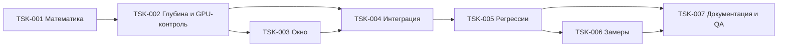

# Задачи: цветная карта глубины

## Информация о документе
- Версия: 1.0. Дата: 2026-11-18. Ветка: `lidar-map`.
- Статус: утверждён пользователем 2026-11-18; реализация и приёмка завершены.
- Основание: [requirements.md](requirements.md) и [design.md](design.md), утверждены пользователем.
- Техническое решение: [.kiro/decisions/0001-depth-map-render-pass.md](../../decisions/0001-depth-map-render-pass.md).
- Все пути в задачах отсчитываются от `experiments/rds-2p_mujoco_wasm`.

## Подход к реализации
Сначала проверить математику и реальный проход глубины на контрольной геометрии: это главный технический риск. Затем добавить окно и подключение к симулятору, проверить совместную работу и измерить производительность. Текущий стек JavaScript ESM / Three.js сохраняется.

Перед реализацией загрузить quality-assurance, перечитать полный комплект спеки и проверить git status. До начала изменений установить зависимости из package-lock.json, запустить существующие применимые проверки и сохранить исходный результат. Любой FAIL сначала диагностировать и исправить либо явно обозначить как внешнюю/известную проблему по правилам проекта.

## План реализации

### Этап 1. Расстояния и получение глубины

- [x] **TSK-001 — Реализовать преобразование глубины и фиксированную палитру.**
  - **Факт:** `node --test tools/check_depth_math.mjs`: 3 PASS; известные значения, границы, палитра и ориентация.
  - **Requirement:** FR-3, FR-4.
  - **Dependencies:** одобрение этого плана.
  - **Deliverables:** `src/vision/depth-math.js`, `tools/check_depth_math.mjs`.
  - **Содержание:** распаковка RGBA по Three.js 0.181.2, осевая глубина в метрах, белый sentinel и невалидные значения, диапазон до 2 м с epsilon 1 мм; палитра и вертикальное преобразование строк.
  - **Acceptance:** `node --test tools/check_depth_math.mjs` завершается PASS; проверены независимые опорные значения, near/far, 2.00/2.01 м, NaN, известные цвета и асимметричный тест строк без зеркального отражения. Проверка не ограничивается round-trip одной и той же формулы.

- [x] **TSK-002 — Получить глубину визуальной сцены с центрального ракурса.**
  - **Факт:** браузерный `check_depth_map.html`: 20 PASS; максимальная ошибка на 2 м — 0.000207 м. См. .kiro/decisions/0001-depth-map-render-pass.md и evidence.md.
  - **Requirement:** FR-2, FR-3, FR-5, FR-6; совместимость общего renderer.
  - **Dependencies:** TSK-001.
  - **Deliverables:** основа `src/vision/depth-map.js`; `tools/check_depth_map.html`, `tools/check_depth_map.js`.
  - **Содержание:** отдельный экземпляр камеры через существующую фабрику; near 0.001, far 3, FOV и transform как у RGB; RGBA8 target 320×240 и MeshDepthMaterial; контролируемый фон и очистка; чтение и раскраска; повторное использование буферов. Сохранение и восстановление всех изменяемых параметров scene/renderer в finally.
  - **Acceptance:** браузерная контрольная сцена показывает плоскости на 0.5/1/1.5/2 м с ошибкой ≤2 см вне границ геометрии; 2.01 м и пустой фон нейтральны. Проверены осевая глубина по краям кадра, перекрытие ближним объектом и ориентация. Снимок состояния renderer совпадает до/после прохода, включая искусственную ошибку readback. RGB-камера и её far не изменены.

### Этап 2. Окно и интеграция

- [x] **TSK-003 — Добавить окно карты, шкалу и управление с клавиатуры.**
  - **Факт:** `python tools/check_depth_browser.py` PASS: окно, Escape, фокус, viewport 390×650 и шкала; `.test/depth/depth-desktop.png`.
  - **Requirement:** FR-1, FR-4, FR-6.
  - **Dependencies:** TSK-002.
  - **Deliverables:** разметка и кнопка в `index.html`, `src/vision/depth-map.css`, UI-часть `src/vision/depth-map.js`.
  - **Содержание:** немодальное окно вне скрываемой вкладки CV; canvas 4:3; легенда 0/0.5/1/1.5/2 м; нейтральный образец; подпись об осевой глубине и данных симулятора. Кнопка открытия, закрытие, фокус, aria-label/aria-expanded, состояния загрузки/ошибки.
  - **Acceptance:** окно помещается на широком и узком viewport, canvas не искажён; доступно при любой вкладке и без YOLO. Кнопки и Escape внутри окна работают с клавиатуры; фокус возвращается кнопке открытия; существующая остановка движения через Escape сохраняется.

- [x] **TSK-004 — Подключить карту к кадру сцены и жизненному циклу приложения.**
  - **Факт:** `check_depth_browser.py` PASS: положение/поворот, pause-drag, reset, hidden, GPU loss/restore и pagehide/pageshow; закрытое окно не захватывает кадры.
  - **Requirement:** FR-2, FR-6; сохранение RGB, YOLO и управления.
  - **Dependencies:** TSK-002, TSK-003.
  - **Deliverables:** изменения `src/main.js`, `src/sim/sim.js`; завершение `DepthMap.open/close/update/invalidate/dispose`.
  - **Содержание:** создание после успешной инициализации sim; необязательный `onDepthFrame` после синхронизации поз и вспомогательной геометрии; лимит 10 Гц без собственного цикла и без догоняющих кадров. Reset инвалидирует старое изображение; закрытие и скрытая страница останавливают измерения. Обработать pause-drag, context lost/restored, pagehide/pageshow с bfcache. Ошибка карты не прерывает основной render.
  - **Acceptance:** карта соответствует движению/наклону; на паузе отражает перетаскивание; после reset не показывает старую сцену. В закрытом/скрытом состоянии счётчик измерений не растёт; при повторном открытии появляется свежий кадр. После dispose нет камеры глубины и её слушателей; повторный dispose безопасен. Карта не зависит от window.__vision и не использует ROS как источник.

### Этап 3. Приёмка и производительность

- [x] **TSK-005 — Проверить карту в рабочем симуляторе и исключить регрессии.**
  - **Факт:** `check_depth_browser.py --perf`: 25 проверок плюс 20 GPU PASS; существующие browser YOLO и mock ROS PASS. Границы synthetic lifecycle проверок указаны в evidence.md.
  - **Requirement:** FR-1–FR-6.
  - **Dependencies:** TSK-004.
  - **Deliverables:** расширенные браузерные проверки, протокол в `.kiro/specs/depth-map/evidence.md`, скриншоты с указанием условий.
  - **Содержание:** проверить реальную сцену (декор, пол, шарики, видимость корпуса), положение картинки и заслонение. Проверить 20 открытий/закрытий, reset, смену вкладок, hidden/visible, восстановление страницы, ошибку GPU и загрузки YOLO; совместную работу RGB/YOLO, управления и режима ROS-подключения без подмены источника карты.
  - **Acceptance:** все применимые сценарии дизайна подтверждены; число камер/обработчиков не растёт за 20 циклов; нет новых ошибок и поломок RGB/управления. Существующие применимые проверки проекта проходят. Недоступные проверки отмечены как непроверенные, а не PASS; задача не закрывается при незакрытых обязательных сценариях.

- [x] **TSK-006 — Измерить частоту карты и влияние на FPS.**
  - **Факт:** четыре 30-секундных прогона PASS. 320×240, настройка 12 Гц; измерено 11.9993 Гц без YOLO и 11.9987 Гц с YOLO; медиана 200 FPS во всех режимах на данном GPU. Точные значения: evidence.json.
  - **Requirement:** нефункциональные требования; FR-6.
  - **Dependencies:** TSK-005.
  - **Deliverables:** измерения и выбранные настройки в `evidence.md`; при необходимости настройка размеров target/частоты без новых зависимостей.
  - **Содержание:** после прогрева провести одинаковые 30-секундные прогоны: без карты, с картой, с YOLO без карты и с YOLO плюс карта. Зафиксировать устройство, GPU, браузер, viewport, медиану FPS, p95 времени основного кадра, capture/readback/colorize и actualHz карты.
  - **Acceptance:** ≥10 обновлений/с и снижение медианного FPS ≤20% относительно соответствующего режима без карты. Если 320×240 не укладывается, проверить предусмотренные дизайном 160×120 при 10 Гц и явно указать выбранное разрешение; если цель всё ещё не достигнута — вернуться к дизайну до закрытия задачи. 15 Гц включать только при успешном замере. Закрытие окна прекращает дополнительные захваты.

- [x] **TSK-007 — Обновить инструкцию и закрыть приёмку по требованиям.**
  - **Факт:** README и спека синхронизированы, evidence.md/evidence.json сохранены, JS syntax и `git diff --check` PASS. Повторное read-only ревью без новых actionable ошибок. См. .kiro/decisions/0001-depth-map-render-pass.md.
  - **Requirement:** FR-1–FR-6, нефункциональные требования.
  - **Dependencies:** TSK-005, TSK-006.
  - **Deliverables:** `README.md`, актуальные `requirements.md`, `design.md`, `tasks.md`, `evidence.md`; итог quality-assurance.
  - **Содержание:** описать запуск, кнопку карты, шкалу, осевую глубину, выбранную частоту/разрешение и синтетический источник. Сверить каждый критерий с evidence, проверить diff/синтаксис затронутых JS и применимые проверки; убрать только созданные временные артефакты.
  - **Acceptance:** полная трассировка требований к фактическим проверкам; все обязательные проверки PASS; `git diff --check` без ошибок. В каждом закрытом TSK есть `Факт:` со ссылкой на проверку; для технического выбора — `Факт: см. .kiro/decisions/0001-depth-map-render-pass.md`. Progress и критерии требований синхронны. Коммиты и публикация — только по отдельному запросу.

## Расширение 2026-11-18
- [x] **TSK-008 — Добавить перетаскивание окна за заголовок.**
  - **Факт:** 32 browser + 20 GPU PASS, mouse/touch, границы, resize/reopen, cancel/lost capture и сохранённая позиция после пересоздания контроллера; drag-evidence.json.
  - **Requirement:** FR-7; `.kiro/specs/depth-window-drag/requirements.md`.
  - **Dependencies:** TSK-003, TSK-004.
  - **Deliverables:** pointer drag в depth-map.js, стили захвата, подсказка, проверки и README.
  - **Acceptance:** браузерный drag мышью/касанием, границы, resize/reopen, отмена/закрытие PASS; камера не смещается, проверки карты не ломаются.

## Граф зависимостей

## Трассировка
| Требование | Задачи |
|---|---|
| FR-1: окно | TSK-003, TSK-005, TSK-007 |
| FR-2: ракурс и движение | TSK-002, TSK-004, TSK-005 |
| FR-3: метры и диапазон | TSK-001, TSK-002, TSK-005 |
| FR-4: шкала | TSK-001, TSK-003, TSK-005 |
| FR-5: поверхности | TSK-002, TSK-005 |
| FR-6: независимость и ресурсы | TSK-002–TSK-007 |
| Производительность | TSK-004, TSK-006, TSK-007 |
| FR-7: перемещение окна | TSK-008 |

## Progress
| Задача | Статус | Факт / evidence |
|---|---|---|
| TSK-001 | Выполнена | 3 unit PASS |
| TSK-002 | Выполнена | 20 GPU/browser PASS |
| TSK-003 | Выполнена | Browser/UI PASS |
| TSK-004 | Выполнена | Browser/lifecycle PASS |
| TSK-005 | Выполнена | Browser + YOLO + mock ROS PASS |
| TSK-006 | Выполнена | 4 замера PASS, evidence.json |
| TSK-007 | Выполнена | README, спека, evidence и QA готовы |
| TSK-008 | Выполнена | 32 browser + 20 GPU PASS, drag-evidence.json |

Выполнено: 8 из 8 задач реализации с учётом расширения про перемещение окна. Базовая спека утверждена 2026-11-18, расширение оформлено micro-spec без дополнительных гейтов. Критерии приёмки подтверждены в evidence.md; коммиты и публикация не выполнялись.

### Уточнение исходной проверки (micro-spec, 2026-11-18)
`check_blue_ball.mjs` падает до изменений фичи: mock кнопки не содержит style.setProperty и Object.create обходит инициализацию color. Исправить только тестовую оснастку (добавить style и blue), сохранив все assertions и production-поведение. Приёмка: эта же команда PASS; затем остальные исходные проверки.

`check_ros_browser.py` не может нажать ROS-панель, скрытую существующим production CSS (`display:none`). В fixture явно показать экспериментальные контролы без изменения приложения и сохранить все проверки транспорта. Добавить проверку независимости карты при mock ROS-подключении. Приёмка: полный браузерный сценарий PASS, без подключения к железу.

## Проверка плана
- [x] Для всех задач указаны Requirement, Deliverables, Acceptance и зависимости.
- [x] Все FR и компоненты дизайна включены в план.
- [x] Математика и GPU проверяются до интеграции UI.
- [x] Обязательные регрессии, ошибки, жизненный цикл и замеры включены.
- [x] Получено явное одобрение задач перед реализацией 2026-11-18.
